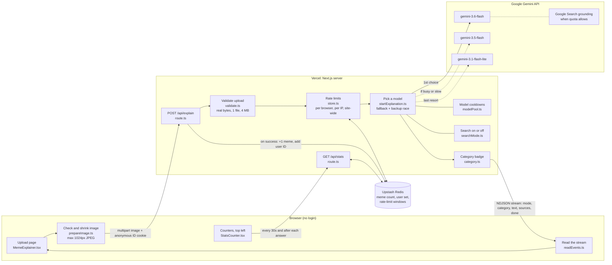

# System design

Meme Context Finder is a single Next.js app on Vercel. The browser uploads one image; a server route checks it, applies rate limits, asks Google Gemini to explain it, and streams the answer back. Upstash Redis keeps the counters and rate limits.

## Diagram

## How a request works

1. **Upload in the browser.** The page takes one image by drag-and-drop or file picker and rejects anything that isn't a raster image. It shrinks the image to at most 1024px as a JPEG (HEIC that the browser can't decode is sent as-is), then posts it to `/api/explain`. Shrinking keeps uploads small, which helps the answer start quickly.

2. **Check the upload on the server.** The route gives the browser an anonymous ID cookie if it has none; this ID counts unique users without a login. It then reads the file's actual bytes, not its name or claimed type, and accepts only one PNG, JPEG, WEBP or HEIC up to 4 MB, with no other form fields. Anything else gets a 400, 413 or 415 error before Gemini is called.

3. **Apply rate limits.** Upstash Redis holds sliding windows per browser (5 a minute, 30 a day), per IP (10 a minute, 60 a day) and for the whole site (sized to the Gemini free tier). A blocked request gets a 429 with "try again in N seconds".

4. **Pick a Gemini model.** `startExplanation` tries `gemini-3.6-flash` first, with Google Search grounding when available. If search is refused, the same model is retried without it, using a prompt that forbids claiming anything was looked up. If a model is over quota or overloaded, it goes on cooldown (following Google's retry hint) and the next model is tried. If the first model hasn't started answering within 2.5 seconds, a backup model is started in parallel and whichever answers first wins.

5. **Stream the answer.** The server waits for Gemini's first chunk, so failures come back as proper HTTP errors, and then streams newline-delimited JSON events: the mode (with or without search), the category, the text as it's written, the web sources, and `done`. The model writes a hidden `[[CATEGORY:n]]` marker first, which the server turns into the badge: full context, partly guessed, or none found. When search ran but found no sources, a "full context" claim is lowered to "partly guessed".

6. **Show it on the page.** The browser reads the stream as it arrives and renders the badge, the Markdown explanation and any source links. Errors such as "service busy" show a friendly message and a Retry button.

7. **Update the counters.** Only a finished explanation counts: the server adds 1 to the meme count and adds the browser's ID to a Redis set, whose size is the user count. The counters in the top-left corner read `GET /api/stats` every 30 seconds and after each answer.

## Where things run

| Part | Runs on | Notes |
|---|---|---|
| Page and image prep | Visitor's browser | React client components |
| `/api/explain`, `/api/stats` | Vercel serverless functions | Node runtime, up to 60s per request |
| Explanations | Google Gemini API | Free tier; key stored as a Vercel secret |
| Counters and rate limits | Upstash Redis | Free plan; in-memory fallback for local development |

Images are never stored: they stay in memory for the request and are sent only to Gemini. Model cooldowns and the search on/off switch are kept in memory per server instance.
